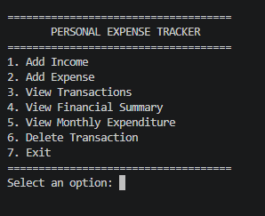
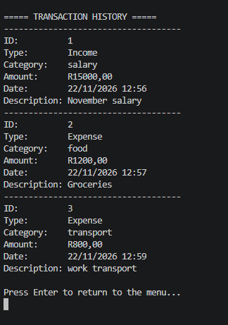
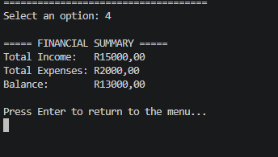
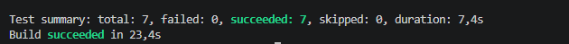

# Personal Expense Tracker

A simple C# console application for managing personal income and expenses. It allows users to record transactions, monitor spending, calculate their balance and review monthly expenditure.

## Features

- Record income transactions.
- Record expense transactions.
- Categorise transactions.
- View transaction history.
- View total income and expenses.
- Calculate current account balance.
- View monthly expenditure.
- Delete transactions.
- Save and load transaction data using JSON.
- Validate user input.

## Technologies Used

- **C#** – Application development
- **.NET 10** – Development framework
- **JSON** – Local data storage
- **xUnit** – Automated unit testing
- **Git and GitHub** – Version control and source code hosting
- **Visual Studio Code** – Development environment

## Screenshots

### Main Menu



### Transaction History



### Financial Summary



### Automated Test Results



## Project Structure

```text
PersonalExpenseTracker/
│
├── PersonalExpenseTracker.Tests/
│   ├── PersonalExpenseTracker.Tests.csproj
│   └── UnitTest1.cs
│
├── screenshots/
│   ├── main-menu.png
│   ├── transaction-history.png
│   ├── financial-summary.png
│   └── test-results.png
│
├── Program.cs
├── Transaction.cs
├── TransactionManager.cs
├── PersonalExpenseTracker.csproj
├── README.md
└── .gitignore
```

## Requirements

- .NET 10 SDK
- Visual Studio Code or Visual Studio

## Installation and Setup

Clone the repository:

```bash
git clone https://github.com/StevenMoleya/PersonalExpenseTracker.git
```

Navigate to the project directory:

```bash
cd PersonalExpenseTracker
```

Restore the project dependencies:

```bash
dotnet restore
```

## Running the Application

Start the application using:

```bash
dotnet run
```

The console menu provides access to the available transaction management features.

## Running Automated Tests

The project includes automated unit tests using xUnit.

To execute the tests, run the following command from the main project directory:

```powershell
dotnet test .\PersonalExpenseTracker.Tests\PersonalExpenseTracker.Tests.csproj
```

**Test results:** 7 passed, 0 failed.

## Data Storage

Transaction records are stored locally in a JSON file. This allows recorded transactions to remain available when the application is closed and reopened.

The transaction data is stored separately from the source code and is excluded from Git tracking.

## Project Purpose

This project was developed to strengthen practical C# programming skills, particularly in:

- Object-oriented programming
- Classes and methods
- Collections and data management
- File handling and JSON serialization
- Input validation
- Unit testing

## Author

**Steven Moleya**

- GitHub: [StevenMoleya](https://github.com/StevenMoleya)
- Project Repository: [Personal Expense Tracker](https://github.com/StevenMoleya/PersonalExpenseTracker)
